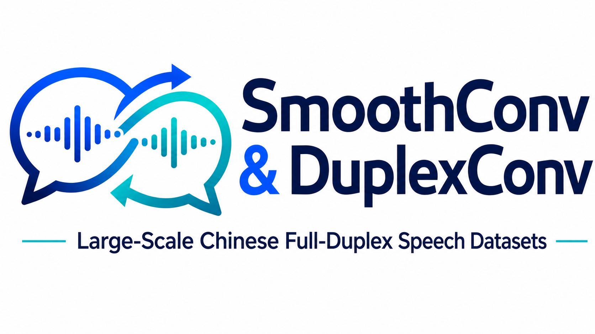

<p align="center">
  
</p>

# SmoothConv & DuplexConv: Large-Scale Chinese Full-Duplex Speech Datasets for Conversational AI

<p align="center">
  <a href="https://arxiv.org/abs/2610.11150"></a>
  <a href="https://qualialabsai.github.io/SmoothConv-DuplexConv"></a>
  <a href="https://huggingface.co/datasets/qualialabsAI"></a>
  <a href="https://github.com/qualialabsAI/SmoothConv-DuplexConv"></a>
</p>

This is the official repository for the **SmoothConv** and **DuplexConv** datasets, co-developed by **ASLP@NPU** and **QualiaLabs**.

## Introduction

Open-source Chinese speech corpora remain dominated by single-speaker, read, or scripted data. **Multi-channel, spontaneous full-duplex multi-party conversation**, with overlapping speech, backchannels, interruptions, pauses, and turn transitions, is still scarce.

**SmoothConv** and **DuplexConv** are constructed from the **same underlying conversational sources** and are designed to complement each other. Together they provide **2,100 hours** of natural Chinese dialogue in **Tutoring** and **Social Chat**. In the released directory layout, **Tutoring** data appear under folders prefixed with `edu` or `Edu`; **Social Chat** data appear under folders prefixed with `none_Edu`. **SmoothConv** (100 hours) offers high-fidelity expert human annotations for benchmarking and supervised training; **DuplexConv** (2,000 hours) provides large-scale LLM-assisted annotations for Speech LLM pre-training and data-driven modeling of conversational speech systems.

> 🎬 **[Demo Page](https://qualialabsai.github.io/SmoothConv-DuplexConv)** · Annotation sample videos and dataset distribution charts.

---

## News

- **2026/06**: Official open-source release of **[SmoothConv](https://huggingface.co/datasets/qualialabsAI/SmoothConv)** (100h) and **[DuplexConv](https://huggingface.co/datasets/qualialabsAI/DuplexConv)** (2,000h).
- **2026/04/06**: Released the **[FastTurn Test Set](https://huggingface.co/datasets/ASLP-lab/FastTurn-Testset)**, constructed from a subset of SmoothConv data, for turn-state prediction evaluation.

---

## Download

* **SmoothConv**: [HuggingFace](https://huggingface.co/datasets/qualialabsAI/SmoothConv)
* **DuplexConv**: [HuggingFace](https://huggingface.co/datasets/qualialabsAI/DuplexConv)
* **FastTurn Test Set**: [HuggingFace](https://huggingface.co/datasets/ASLP-lab/FastTurn-Testset)

---

## Dataset Overview

### SmoothConv (100 Hours — Expert Human Annotation)

**SmoothConv** contains **100 hours** of naturally occurring multi-party Chinese conversations in multi-channel **Tutoring** and **Social Chat** recordings. Unlike corpora dominated by read or scripted speech, it captures realistic full-duplex dynamics: overlapping speech, backchannels, interruptions, pauses, and turn transitions. Trained experts provide fine-grained labels, including:

- **Aligned transcripts** with millisecond-level timestamps
- **Turn-taking & overlap** (speaker switches, overlaps, floor-holding)
- **Pauses & sound events** (laughter, coughs, breaths, silence, etc.)
- **Speaker attributes** (gender, age, emotion, and related interaction tags)

### DuplexConv (2,000 Hours — LLM-Assisted Annotation)

**DuplexConv** scales to **2,000 hours** in the same domains, sharing a unified data design with SmoothConv. An LLM-assisted pipeline produces transcripts, speaker-aware conversational structures, turn-level interaction information, and scene-level contextual labels for large-scale Speech LLM pre-training and data-driven modeling.

Together, SmoothConv and DuplexConv bridge fine-grained human annotation and large-scale training in realistic full-duplex settings. See the [Demo Page](https://qualialabsai.github.io/SmoothConv-DuplexConv) for distribution charts.

---

## Dataset Statistics

| | SmoothConv | DuplexConv |
| :--- | :---: | :---: |
| **Annotation** | Expert human | LLM-assisted |
| **Duration** | 100.53 h | 2,000.21 h |
| **Audio files** | 2,503 | 93,709 |
| **Mean clip length** | 144.6 s | 76.8 s |
| **Clip length range** | 60.0 – 634.7 s | 8.0 – 618.3 s |
| **Domains** | Tutoring (`edu*` / `Edu*`), Social Chat (`none_Edu*`) | Tutoring (`edu*` / `Edu*`), Social Chat (`none_Edu*`) |


---

## SmoothConv Benchmark

The **SmoothConv Benchmark** is a task-oriented evaluation suite derived from the human-verified SmoothConv corpus. It covers three representative problems in multi-party speech interaction: **speech separation**, **multi-speaker automatic speech recognition (MSASR)**, and **turn detection**.

All training and evaluation partitions are strictly separated by conversation session and speaker. When SmoothConv is included in training, all benchmark samples are excluded to prevent data leakage.

### Benchmark Statistics

The speech separation and MSASR tasks share a natural conversational evaluation set with synchronized participant-level tracks.

| Statistic | Speech Separation / MSASR Evaluation Set |
| :--- | :---: |
| **Duration** | 9.48 h |
| **Clips** | 255 |
| **Average duration** | 133.9 s |
| **Speaker configuration** | 2–4 speakers |
| **Scenario distribution** | Tutoring 56.0% / Social Chat 44.0% |
| **Speaker split** | Disjoint |
| **Speech overlap ratio** | 3.33% |

Turn detection uses an independent set of short dialogue clips annotated with four interaction states. Because explicit `wait` behavior is rare in natural conversation, 1,000 evaluation-only wait samples were synthesized with DeepSeek V3 and IndexTTS2 and then manually checked.

| Turn state | Samples | Duration |
| :--- | ---: | ---: |
| **Complete** | 14,709 | 9.64 h |
| **Incomplete** | 3,643 | 2.15 h |
| **Backchannel** | 3,080 | 0.42 h |
| **Wait** | 1,000 | 0.71 h |

---

## Experiments

We evaluate SmoothConv and DuplexConv on three downstream tasks that cover complementary aspects of interactive speech processing:

- **Speech separation:** recovering participant-level signals from overlapping conversational speech.
- **MSASR:** recognizing both *who spoke* and *what was said*.
- **Turn detection:** identifying conversational states and interaction boundaries.

### Speech Separation

We train **SPMamba** under four data configurations. Every configuration uses 480 hours of training data. `Sim.` denotes simulated mixtures from WSJ0-2mix, WHAM!, WHAMR!, and Libri2Mix; `DC` denotes mixtures constructed from DuplexConv participant tracks; and `SC` denotes SmoothConv. Evaluation covers simulated mixtures, the SmoothConv Benchmark, and two out-of-domain conversational datasets, AliMeeting and AISHELL-4.

We report scale-invariant signal-to-distortion ratio improvement (**SI-SDRi**, higher is better) and character error rate (**CER**, lower is better). CER is computed by applying X-ASR-zh-en to the separated signals. SI-SDRi is unavailable for the out-of-domain sets because clean source references are not provided.

**In-domain evaluation**

| Training data | Simulated<br>SI-SDRi ↑ | Simulated<br>CER ↓ | SmoothConv<br>SI-SDRi ↑ | SmoothConv<br>CER ↓ |
| :--- | ---: | ---: | ---: | ---: |
| Sim. | **14.87** | 31.99 | 13.55 | 81.24 |
| DC | 7.13 | 37.17 | **17.26** | **32.15** |
| DC + Sim. | 13.46 | **29.29** | 15.63 | 45.41 |
| DC + Sim. + SC | 12.32 | 29.73 | 15.70 | 42.59 |

**Out-of-domain evaluation (CER ↓)**

| Training data | AliMeeting | AISHELL-4 |
| :--- | ---: | ---: |
| Sim. | 65.29 | 68.49 |
| DC | **42.26** | 37.66 |
| DC + Sim. | 53.67 | 40.75 |
| DC + Sim. + SC | 45.48 | **36.04** |

**Key findings.** DuplexConv-only training performs best on the natural SmoothConv conversations and AliMeeting, while adding SmoothConv produces the lowest CER on AISHELL-4. Simulated and conversational mixtures therefore provide complementary supervision, and participant-level DuplexConv tracks are effective training material for real conversational speech separation.

### Multi-Speaker Automatic Speech Recognition

For MSASR, we adapt **SoulX-Transcriber** with LoRA while keeping the backbone frozen. Models are fine-tuned for one epoch with a learning rate of `1e-5`, a warmup ratio of `0.05`, LoRA rank `8`, and LoRA alpha `32`. We report diarization error rate (**DER**), concatenated minimum-permutation word error rate (**cpWER**), and time-constrained cpWER (**tcpWER**); all are percentages and lower is better. DER uses a 0.25-second collar.

All MSASR metrics are percentages; lower is better.

<table>
  <thead>
    <tr>
      <th>Evaluation set</th>
      <th>Training data</th>
      <th align="right">DER ↓</th>
      <th align="right">cpWER ↓</th>
      <th align="right">tcpWER ↓</th>
    </tr>
  </thead>
  <tbody>
    <tr>
      <td rowspan="3"><strong>SmoothConv-Bench</strong></td>
      <td>Baseline</td><td align="right">40.89</td><td align="right">27.04</td><td align="right">27.95</td>
    </tr>
    <tr><td>DC</td><td align="right">13.50</td><td align="right">17.38</td><td align="right">18.22</td></tr>
    <tr><td>DC + SC</td><td align="right"><strong>12.73</strong></td><td align="right"><strong>16.87</strong></td><td align="right"><strong>17.62</strong></td></tr>
    <tr>
      <td rowspan="3"><strong>AliMeeting-Near</strong></td>
      <td>Baseline</td><td align="right">4.48</td><td align="right">12.52</td><td align="right">11.65</td>
    </tr>
    <tr><td>DC</td><td align="right">0.71</td><td align="right">8.27</td><td align="right">7.56</td></tr>
    <tr><td>DC + SC</td><td align="right"><strong>0.68</strong></td><td align="right"><strong>8.14</strong></td><td align="right"><strong>7.43</strong></td></tr>
    <tr>
      <td rowspan="3"><strong>AliMeeting-Far</strong></td>
      <td>Baseline</td><td align="right"><strong>12.82</strong></td><td align="right"><strong>25.88</strong></td><td align="right"><strong>25.08</strong></td>
    </tr>
    <tr><td>DC</td><td align="right">20.29</td><td align="right">30.17</td><td align="right">30.92</td></tr>
    <tr><td>DC + SC</td><td align="right">18.37</td><td align="right">29.18</td><td align="right">29.76</td></tr>
    <tr>
      <td rowspan="3"><strong>AMI-SDM</strong></td>
      <td>Baseline</td><td align="right">16.15</td><td align="right">73.66</td><td align="right">97.75</td>
    </tr>
    <tr><td>DC</td><td align="right">15.56</td><td align="right">74.04</td><td align="right">97.56</td></tr>
    <tr><td>DC + SC</td><td align="right"><strong>14.57</strong></td><td align="right"><strong>73.28</strong></td><td align="right"><strong>97.31</strong></td></tr>
  </tbody>
</table>

**Key findings.** DuplexConv adaptation substantially improves both speaker diarization and transcription on SmoothConv-Bench. Combining DuplexConv with human-verified SmoothConv gives the best results on SmoothConv-Bench, AliMeeting-Near, and AMI-SDM. The weaker AliMeeting-Far results indicate that far-field acoustic mismatch remains an important cross-domain challenge.

### Turn Detection

We train **FastTurn** with three configurations: the EasyTurn training set (`ET`), DuplexConv (`DC`), and DuplexConv combined with SmoothConv (`DC + SC`). Recall is reported for four turn states: **Complete (C)**, **Incomplete (I)**, **Backchannel (B)**, and **Wait (W)**. Higher is better.

**EasyTurn-Test recall (%)**

| Training data | Complete ↑ | Incomplete ↑ | Backchannel ↑ | Wait ↑ |
| :--- | ---: | ---: | ---: | ---: |
| ET | 93.33 | 85.00 | 87.00 | **98.00** |
| DC | **99.67** | 87.67 | 76.00 | 91.00 |
| DC + SC | 98.00 | **91.00** | **93.00** | 96.00 |

**SmoothConv-Bench recall (%)**

| Training data | Complete ↑ | Incomplete ↑ | Backchannel ↑ | Wait ↑ |
| :--- | ---: | ---: | ---: | ---: |
| ET | 78.29 | 73.03 | 92.57 | **95.70** |
| DC | 87.67 | 72.85 | 93.78 | 89.60 |
| DC + SC | **89.20** | **74.66** | **94.15** | 91.30 |

**Key findings.** DuplexConv provides strong supervision for complete-turn recognition, while adding SmoothConv improves the more subtle incomplete and backchannel states. `DC + SC` achieves the best recall on three of four states on SmoothConv-Bench, showing the complementary value of large-scale automatic annotation and high-quality human verification. Wait detection remains challenging because natural wait events are sparse and its benchmark subset is synthesized.

### Overall Takeaways

- **DuplexConv scales training:** its automatically annotated conversational data consistently improves models over their original or non-conversational baselines.
- **SmoothConv improves precision:** adding human-verified SmoothConv data further benefits speaker-aware recognition and fine-grained turn-state modeling.
- **Natural conversations matter:** models trained with conversational participant tracks generalize better to real multi-speaker conditions than models trained only on simulated mixtures.
- **The two datasets are complementary:** DuplexConv supplies scale, while SmoothConv provides reliable supervision and evaluation.

---

## Contact

For questions or collaboration: [jimz@qualialabs.ai](mailto:jimz@qualialabs.ai)

---

## Ethics Statement

Guidelines for the responsible collection, release, and use of SmoothConv and DuplexConv.

- **Informed consent.** Conversations were recorded with the knowledge and consent of participants. Personal identifiers have been removed or anonymized prior to release.
- **Privacy protection.** The datasets are released for academic and research purposes only. Users must not attempt to re-identify speakers or reconstruct private information from the audio or annotations.
- **Intended use.** SmoothConv and DuplexConv are intended for research on spoken dialogue, turn-taking, and speech understanding. They must not be used for unauthorized surveillance, impersonation, or generating deceptive content.
- **Limitations & bias.** Annotations may contain errors; DuplexConv labels are machine-assisted. Researchers should account for domain, demographic, and annotation bias when training or evaluating models.
- **Responsible use.** By using these datasets, you agree to comply with applicable laws and ethical guidelines. Report suspected misuse to [jimz@qualialabs.ai](mailto:jimz@qualialabs.ai).

---

## License

Released under [CC BY-NC 4.0](https://creativecommons.org/licenses/by-nc/4.0/).

---

## Citation

If you use SmoothConv or DuplexConv in your research, please cite:


```bibtex
@misc{wang2026smoothconvduplexconvcomplementarymandarin,
      title={SmoothConv and DuplexConv: Complementary Mandarin Multi-Party Conversational Speech Corpora for Speech Interaction}, 
      author={Chengyou Wang and Mingchen Shao and Chunjiang He and Zeyu Zhu and Jierui Guo and Bingshen Mu and Zikai Liu and Hanke Xie and Yuhang Dai and Zhou Zhu and Lei Xie},
      year={2026},
      eprint={2610.11150},
      archivePrefix={arXiv},
      primaryClass={eess.AS},
      url={https://arxiv.org/abs/2610.11150}, 
}
```
